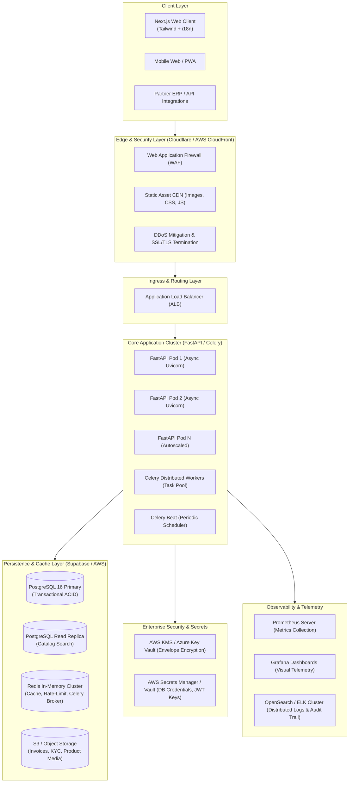

# End-to-End System Architecture: Noryvanta Business Marketplace

## 1. System Topology Overview (C4 Container View)



---

## 2. Cloud Infrastructure Mapping: AWS & Azure

| Component | AWS Implementation | Azure Implementation | Multi-Cloud / Self-Hosted |
| :--- | :--- | :--- | :--- |
| **Compute Orchestration** | AWS ECS Fargate or EKS (Kubernetes) | Azure Container Apps / AKS | Docker Compose / Nomad |
| **Relational Database** | Amazon RDS PostgreSQL / Supabase AWS | Azure Database for PostgreSQL | PostgreSQL 16 + pgvector |
| **In-Memory Cache & Broker**| Amazon ElastiCache for Redis | Azure Cache for Redis | Redis 7+ Cluster |
| **Object Storage** | Amazon S3 (Standard + Glacier) | Azure Blob Storage | MinIO / Supabase Storage |
| **Key & Secret Management** | AWS KMS + Secrets Manager | Azure Key Vault | HashiCorp Vault |
| **Metrics & Monitoring** | Amazon Managed Prometheus | Azure Monitor Metrics | Prometheus + Grafana |
| **Log Aggregation** | Amazon OpenSearch Service | Azure Log Analytics | Elastic / OpenSearch stack |

---

## 3. Cryptographic Security, KMS & Secrets Management

1. **Envelope Encryption for Sensitive B2B Records**:
   - High-sensitivity data (Vendor bank account numbers, tax PANs, financial ledgers) are encrypted prior to database insertion using customer-managed keys (CMK) via AWS KMS or Azure Key Vault.
   - Database stores ciphertext with IV (Initialization Vector) and key reference:
     $$\text{Ciphertext} = \text{AES-256-GCM}(\text{Plaintext}, \text{DataKey})$$
2. **Secrets Rotation**:
   - Database credentials, JWT signing private keys, and third-party SMS/Payment gateway secrets are injected into container environments dynamically at boot via AWS Secrets Manager with 30-day automatic rotation.

---

## 4. Object Storage Architecture (S3 Compatible)

All static and binary assets are partitioned into three dedicated lifecycle tiers:

```
s3://noryvanta-media-bucket/
├── public/
│   ├── products/
│   │   └── {vendor_id}/{product_id}/
│   │       ├── original.webp
│   │       ├── thumb_400x400.webp
│   │       └── hero_1280x720.webp
│   └── branding/
└── secure-private/ (Requires Pre-Signed URL with 300s TTL)
    ├── kyc/
    │   └── {vendor_id}/
    │       ├── gstin_certificate.pdf
    │       └── bank_mandate.pdf
    └── invoices/
        └── {year}/{month}/
            └── INV-{order_number}.pdf
```

---

## 5. Observability & Telemetry Pipeline

### Prometheus & Grafana Metric Telemetry
FastAPI exposes standardized Prometheus metrics at `/metrics` via `prometheus-fastapi-instrumentator`:
- `http_requests_total{method, endpoint, status_code}`: Request rate, error percentages (4xx, 5xx).
- `http_request_duration_seconds_bucket`: Latency percentiles (P95 < 80ms, P99 < 200ms).
- `escrow_funds_locked_inr_total`: Real-time gauge of active funds held in escrow.
- `celery_task_latency_seconds`: Queue wait duration for background workers.

### Centralized Logging via OpenSearch / ELK
- FastAPI writes structured JSON logs to `stdout`.
- Vector / FluentBit daemon collectors ship logs to the OpenSearch / ELK cluster.
- Every log payload is correlated via a unique `X-Correlation-ID` header injected at the Ingress load balancer:
```json
{
  "timestamp": "2026-09-23T19:00:00.124Z",
  "correlation_id": "req-98f2b1a-091a",
  "level": "INFO",
  "service": "noryvanta-api",
  "endpoint": "/api/v1/escrow/ord_5521/deposit",
  "user_id": "usr_99a8b1",
  "action": "ESCROW_DEPOSIT_CONFIRMED",
  "amount": 672600.0,
  "duration_ms": 34.2
}
```
