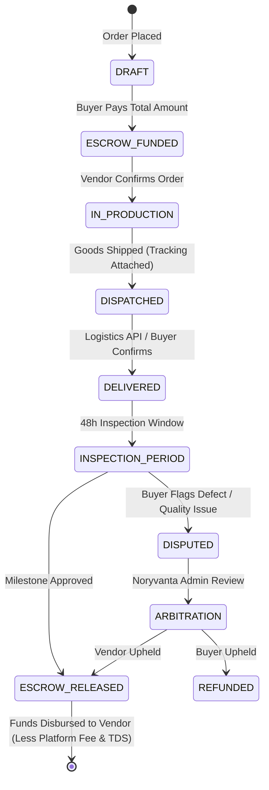

# Backend Architecture & Specification: Noryvanta Business Marketplace

## 1. Overview & Architectural Principles
The **Noryvanta Business Marketplace Backend** is implemented in **Python 3.11+** leveraging **FastAPI**, an asynchronous web framework optimized for high-throughput, low-latency B2B transactional workloads.

The backend adheres strictly to **Clean Architecture / Modular Monolith** principles with high decoupling between routing, domain models, business logic services, and external integrations.

### Primary Technology Stack
- **Framework**: FastAPI (Asynchronous ASGI application via Uvicorn)
- **Data Validation & Schemas**: Pydantic v2 (Strict type checking, high-performance serialization)
- **Object Relational Mapper**: SQLAlchemy 2.0 (Modern 2.0 select syntax, async engine)
- **Database Migrations**: Alembic
- **Asynchronous Task Queue**: Celery with Redis broker and result backend
- **Caching & Rate Limiting**: Redis
- **Security & Cryptography**: Passlib (Bcrypt), PyJWT (HS256 / RS256 for OIDC), Secrets module for secure OTP tokens
- **API Documentation**: Automated OpenAPI 3.1 & Swagger UI (`/docs`, `/redoc`)

---

## 2. Directory & Component Structure
```
backend/
├── app/
│   ├── api/
│   │   └── v1/
│   │       ├── endpoints/
│   │       │   ├── auth.py          # OAuth2, OIDC & OTP login/verification
│   │       │   ├── users.py         # User management, profile & roles
│   │       │   ├── businesses.py    # Vendor profiles, GSTIN verification, KYC
│   │       │   ├── products.py      # B2B Product catalog, tiered pricing, search
│   │       │   ├── orders.py        # Purchase orders, proforma/tax invoicing
│   │       │   ├── escrow.py        # Escrow funds locking, milestones & releases
│   │       │   ├── ai_assistant.py  # LLM-assisted product listing generator
│   │       │   ├── admin.py         # Platform fees, TDS/TCS ledger, gateway routing
│   │       │   └── health.py        # Health check & system telemetry
│   │       └── api.py               # Aggregated v1 API router
│   ├── core/
│   │   ├── config.py                # Environment-driven Pydantic BaseSettings
│   │   ├── security.py              # JWT encoding/decoding, password hashing, OTP generator
│   │   └── database.py              # Engine setup, async session factory, Base declarative
│   ├── models/                      # SQLAlchemy ORM models
│   │   ├── user.py                  # User, RoleEnum, OTPRecord
│   │   ├── business.py              # BusinessProfile, KYCStatus, BankAccount
│   │   ├── product.py               # Product, Category, TierPricing, Inventory
│   │   ├── order.py                 # Order, OrderItem, Invoice
│   │   └── escrow.py                # EscrowAccount, EscrowMilestone, FeeLedger
│   ├── schemas/                     # Pydantic v2 Request & Response models
│   │   ├── auth.py
│   │   ├── user.py
│   │   ├── business.py
│   │   ├── product.py
│   │   ├── order.py
│   │   └── escrow.py
│   ├── services/                    # Domain business logic
│   │   ├── auth_service.py          # Authentication, OTP generation, token rotation
│   │   ├── escrow_service.py        # Escrow lifecycle state machine & commission calculation
│   │   ├── ai_service.py            # AI product descriptions, HSN classification
│   │   └── tax_service.py           # GST, TDS (Sec 194-O) and TCS calculations
│   ├── tasks/                       # Celery tasks
│   │   ├── celery_app.py            # Celery initialization with Redis
│   │   └── worker_tasks.py          # Background jobs (email/SMS dispatch, invoice generation)
│   └── main.py                      # FastAPI initialization, middleware, CORS, lifecycle hooks
├── alembic/                         # Database migration scripts
├── tests/                           # Pytest automated test suite
├── requirements.txt
├── Dockerfile
└── .env.example
```

---

## 3. Authentication & Authorization Subsystem

### Dual-Method Authentication
1. **OTP Authentication**:
   - `POST /api/v1/auth/otp/request`: Generates a cryptographically secure 6-digit OTP stored in Redis with a 5-minute TTL. Triggers Celery worker to dispatch SMS / Email.
   - `POST /api/v1/auth/otp/verify`: Validates OTP against stored hash. Upon verification, issues a pair of JWTs: short-lived Access Token (15-60 min) and long-lived Refresh Token (7-30 days).
2. **OAuth2 / OIDC Integration**:
   - `POST /api/v1/auth/oauth/callback`: Handles OpenID Connect token verification from Identity Providers (Google, Microsoft, Keycloak) and provisions/synchronizes the user entity.

### Role-Based Access Control (RBAC)
FastAPI dependencies verify the user's role via token claims:
- `Role.BUYER`: Can browse catalogs, submit RFQs, deposit funds into escrow, and approve delivery milestones.
- `Role.VENDOR` (Business Owner): Can register business, manage catalogs, view orders, request milestone releases, and view net payouts.
- `Role.ADMIN`: Platform-wide oversight, platform fee configuration, vendor KYC approvals, dispute mediation, and payment gateway routing.

```python
# Security dependency pattern
async def get_current_active_vendor(
    current_user: User = Depends(get_current_user)
) -> User:
    if current_user.role not in [RoleEnum.VENDOR, RoleEnum.ADMIN]:
        raise HTTPException(
            status_code=status.HTTP_403_FORBIDDEN,
            detail="Vendor authorization required for this action."
        )
    return current_user
```

---

## 4. B2B Escrow Engine & State Machine

The core economic driver of Noryvanta is trust-brokered commerce. The escrow engine follows a finite state machine:


### Fee Deduction & Ledger Integrity
Upon `ESCROW_RELEASED`:
1. **Platform Fee**: Configured percentage (e.g. 2.5% to 5.0%) deducted and routed to Noryvanta platform account.
2. **TDS under Section 194-O**: 1% TDS deducted on gross sales for Indian tax compliance and deposited into the government tax ledger.
3. **Net Payout**: Transferred via automated payout gateway (Razorpay Route / Cashfree / Stripe Connect) to the vendor's verified bank account.

---

## 5. Background Task Processing with Celery & Redis
Celery handles asynchronous workloads out of the HTTP request loop:
- `send_otp_notification`: Dispatches SMS and transactional emails.
- `generate_tax_invoice`: Asynchronously compiles GST-compliant PDF invoices with QR codes.
- `sync_logistics_tracking`: Polls shipping aggregator APIs (Delhivery, Shiprocket, BlueDart) to update dispatch milestones.
- `daily_financial_reconciliation`: Computes daily settlement reports, fee summaries, and payout batches.
