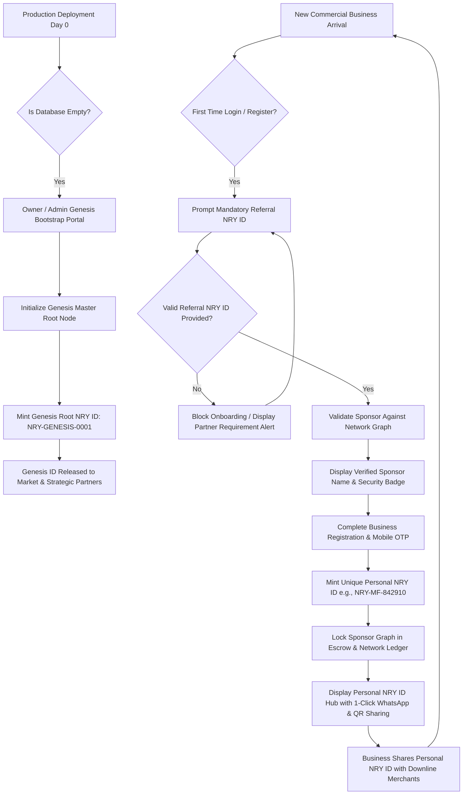

# Noryvanta Referral NRY ID Genesis & Onboarding Architecture Specification

## 1. Executive Summary & Problem Formulation
In the Noryvanta sovereign B2B marketplace, verified network identity is anchored to a Universal Account Identifier (**NRY ID / UAID**). To ensure organic commercial trust, anti-sybil protection, and network reward alignment:
1. **Mandatory Referral Invariant**: Every new commercial entity attempting first-time registration and login **strictly requires a valid, verified Referral NRY ID**. First-time onboarding cannot be completed without it.
2. **Cold-Start Genesis Bootstrap Invariant**: To solve the cold-start initialization paradox (where no users exist on day zero), **only the Platform Owner / Super-Administrator** holds root authorization to initialize the production environment without an incoming referral ID. This provisions the **Genesis Root NRY ID** (`NRY-GENESIS-0001`), which is subsequently released to the market for tier-1 partner onboarding.
3. **Personal NRY ID Minting**: Once any business registers using a valid referral ID, the system automatically mints and issues their unique, immutable **Personal NRY ID**, enabling them to onboard subsequent market participants.

---

## 2. Architectural State Machine & Flow Diagram

---

## 3. Structural Components & Invariants

### 3.1 Genesis Root Node Invariant
- **Root Node Identifier**: `NRY-GENESIS-0001` (or `NRY-HQ-000001`).
- **Sponsor UAID**: `NULL` (Immutable root parent).
- **Authorization**: Restrictable by cryptographic Genesis Master Secret Key or verified Platform Super-Admin role (`role = 'ADMIN'`, `is_superuser = True`).
- **System Behavior**:
  - The Genesis bootstrap endpoint (`/api/v1/network/genesis-bootstrap`) can only be executed when no genesis node exists in the database.
  - If a genesis node already exists, subsequent calls are rejected with `HTTP 409 Conflict: Genesis root node already initialized`.

### 3.2 Mandatory Referral Invariant for First-Time Users
- **First-Time Detection**: When an unauthenticated mobile number or email attempts login via OTP or password, the system checks whether a verified `BusinessProfile` / `User` exists.
- **Interception**: If not registered, the user is transitioned to the **Referral Intercept Gate**.
- **Validation**:
  - Format validation: Regex `^NRY-(GENESIS|[A-Z]{2})-[A-Z0-9]{4,10}$`.
  - Existence check: Queried against `NetworkMember.uaid` and `User.uaid`.
  - Active check: Sponsor account must have `account_activity_status != 'UAID_BLOCKED'`.
- **Pre-fill Support**: Query string parameter `?ref=NRY-XXXX` automatically pre-populates and locks the Referral NRY ID input.

### 3.3 Personal NRY ID Minting Engine
Upon approved business registration:
- **Prefix Formula**: Derived from business classification:
  - Wholesaler: `NRY-HS-`
  - Distributor: `NRY-DS-`
  - Retailer / Shop: `NRY-RT-`
  - Manufacturer: `NRY-MF-`
  - Services: `NRY-SR-`
  - Freelancer: `NRY-FL-`
- **Entropy**: Cryptographic 6-character uppercase alphanumeric hash (e.g. `NRY-MF-7K9W2E`).
- **Storage**:
  - Written transactionally to `User.uaid`, `BusinessProfile.uaid`, and `NetworkMember.uaid`.
  - Creates the permanent entry in `referrals` (`referrer_uaid = sponsor_uaid`, `referred_uaid = new_uaid`).

---

## 4. UI/UX Interaction Design

### 4.1 Login Page (`/login`)
1. **Normal Flow**: Registered users enter phone/email + OTP/password to log in directly to `/dashboard`.
2. **First-Time User Intercept**:
   - Informs the user: *"New business entity detected. Noryvanta B2B network requires an active Referral NRY ID for first-time account initialization."*
   - Immediate input field for `Referral NRY ID` with 1-click continuation to registration.
3. **Admin Genesis Gateway**:
   - Discrete link: *"Platform Owner Genesis Bootstrap Portal →"*
   - Allows root administrator to initialize the Genesis Node on Day 0.

### 4.2 Registration Wizard (`/register`)
1. **Step 1 (Mandatory Referral Verification)**:
   - Input: **Referral NRY ID** (Required).
   - Real-time verification badge:
     - When valid: *"✓ Verified Sponsor: Noryvanta Master Genesis Hub (`NRY-GENESIS-0001`)"* or *"✓ Verified Sponsor: Apex Precision Instruments Pvt. Ltd."*
     - When invalid: *"✗ Invalid or unrecognized NRY ID. Please obtain a valid ID from a registered business partner or platform genesis."*
   - **Genesis Bypass Toggle (Admin / Owner Only)**:
     - Allows Platform Owner to enter the Admin Genesis Key and register the root entity without a referral code.
2. **Step 5 Completion (Personal NRY ID Handover)**:
   - Large highlighted banner:
     - **Personal NRY ID Badge**: `NRY-MF-948124` (with copy button).
     - **QR Code Badge**: Dynamic branded verification QR.
     - **1-Click Share**: "Share on WhatsApp", "Copy Invite Link", "Download QR Code".
     - Notice: *"Share your personal NRY ID across your business network. All commercial partners who register under your ID will be linked to your network tree!"*

---

## 5. Security & Anti-Sybil Safeguards
1. **Circular Referral Prevention**: A business cannot use their own NRY ID or any downline's NRY ID as a referrer.
2. **Idempotent Generation**: Generating personal NRY IDs uses transactional database locks (`_uaid_locks[user_id]`) to prevent race conditions.
3. **Audit Trail**: All referral links and genesis creations are logged in `uaid_generation_logs` with timestamps, IP addresses, and authorization proofs.
