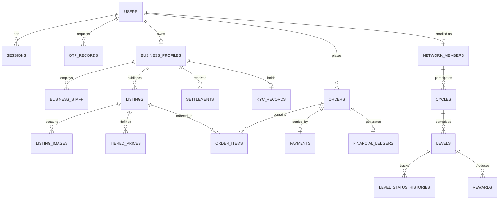

# NORYVANTAGLOBAL.COM — BACKEND MASTER ARCHITECTURAL SPECIFICATION & SYSTEM DESIGN

**Version:** 1.0.0 (Production Blueprint)  
**System Identity:** Noryvanta Sovereign Commerce & Digital Network Infrastructure  
**Core Technologies:** Python 3.11+, FastAPI, PostgreSQL (asyncpg), SQLAlchemy 2.0, Alembic, Redis, Celery / Background Workers, S3-Compatible Object Storage.

---

## 1. UI & STITCH SCREEN DECONSTRUCTION & FEATURE MAPPING

Every visible screen, form, button, card, and workflow from the Stitch design system has been mapped to concrete backend domain models, state machines, and RESTful API endpoints.

| Stitch Screen & ID | Key UI Elements & Controls | Backend Domain & Capabilities | Required APIs |
| :--- | :--- | :--- | :--- |
| **Home & Discovery** (`a3c288be01ec...`) | Search bar, category filters, verified badges, country/language selector | Catalog discovery, geo-filtering, full-text search, localization rules | `GET /api/v1/listings/search`, `GET /api/v1/categories`, `GET /api/v1/localization/countries` |
| **Product Detail** (`ac78a1678524...`) | Image gallery (4-10 images, optional video), tiered pricing table, customer price (NO platform fee), vendor trust badge | Listing metadata, dynamic tier pricing evaluation, vendor trust metrics | `GET /api/v1/listings/{id}`, `GET /api/v1/businesses/{id}/public-profile` |
| **Customer Checkout** (`8a7c5359757e...`) | Delivery address form, order summary, customer payable calculation, COD eligibility check | Order draft creation, address validation, tax calculation (GST), customer invoice draft | `POST /api/v1/orders/draft`, `POST /api/v1/orders/quote` |
| **Checkout & Payment Gateway** (`7afc77e36f7c...`) | Razorpay / Cashfree selector, UPI / Cards / NetBanking options, gateway tokenization | Payment session creation, payment intent, webhook verification, idempotency handling | `POST /api/v1/payments/create-session`, `POST /api/v1/payments/verify`, `POST /api/v1/payments/webhook/{gateway}` |
| **Business Login** (`50d0f3060a00...`) | Mobile/Email input, OTP request/verify, password login, device session | OTP rate-limited generation, secure hashing, JWT token rotation, device audit | `POST /api/v1/auth/otp/request`, `POST /api/v1/auth/otp/verify`, `POST /api/v1/auth/login`, `POST /api/v1/auth/refresh` |
| **Business Registration** (`34411e42ca39...`) | Business name, type, GSTIN/PAN, address, bank accounts, terms acceptance | Profile onboarding state machine (`DRAFT` → `SUBMITTED`), GST validation, terms versioning | `POST /api/v1/businesses/register`, `POST /api/v1/businesses/terms/accept`, `GET /api/v1/businesses/my-business` |
| **Business Dashboard** (`e4ee625af38c...`) | KPI metric cards (Gross, Category fee, Net settlement), recent orders, inventory table | Aggregated financial metrics, platform fee ledger summaries, order pipeline | `GET /api/v1/businesses/dashboard/summary`, `GET /api/v1/businesses/orders`, `GET /api/v1/businesses/settlements` |
| **AI Listing Assistant** (`4a5f10529234...`) | Drag-drop 4-10 images & max 2 videos, AI generate button, editable title/description, highlights | Image metadata validation, AI provider abstraction (LLM/Vision), safe generation | `POST /api/v1/media/upload`, `POST /api/v1/ai/generate-listing`, `POST /api/v1/listings` |
| **Transaction Detail** (`0a3d9d7df26f...`) | Gross transaction, category Noryvanta fee, TDS 194-O, net vendor payout, disbursement timeline | Immutable financial ledger records, fee calculations, audit trail, settlement status | `GET /api/v1/settlements/{id}`, `GET /api/v1/orders/{id}/settlement-ledger` |
| **Network Progress** (`5a65b2b97bfd...`) | Header (UAID, Cycle 1, Level 37, Gold, KYC Green), 120-level tracker, 9 level statuses, Activity timeline, Detail modal | Level state machine, cycle controller, qualification auditor, reward pipeline | `GET /api/v1/network/progress`, `GET /api/v1/network/levels/{level_number}`, `GET /api/v1/network/cycles/history` |
| **Admin Fee Dashboard** (`98750cf997d3...`) | Category fee config (Wholesaler 3.20%, Distributor/Services 5.20%, Retailer 8.20%), global GMV, payout controls | Platform fee rule versioning, financial ledger inspection, settlement disbursement | `GET /api/v1/admin/fees/summary`, `POST /api/v1/admin/fees/config`, `GET /api/v1/admin/ledger` |
| **Admin Gateway Routing** (`53750fa3d371...`) | Gateway toggles (Razorpay, Cashfree), country currency routing, COD threshold limits | Dynamic gateway router, currency matrix, COD risk filters, payment retry policies | `GET /api/v1/admin/gateways/config`, `PUT /api/v1/admin/gateways/routing`, `PUT /api/v1/admin/countries/{code}` |

---

## 2. DATABASE ENTITY ARCHITECTURE (NORMALIZED RELATIONAL MODEL)

All models are built with strict relational integrity, UUID primary keys, foreign keys, timestamps, and indexes.



### Key Entity Specifications:
1. **`users` & `user_roles`**: Customer, Business Owner, Staff, Admin, Super Admin, Support.
2. **`business_profiles`**: Legal name, trade name, GSTIN, PAN, bank details, verification status (`DRAFT`, `SUBMITTED`, `UNDER_REVIEW`, `VERIFIED`, `REJECTED`, `SUSPENDED`).
3. **`kyc_records` & `kyc_documents`**: Private document references with pre-signed temporary URL generation.
4. **`listings` & `listing_images`**: Strict database constraint requiring a minimum of 6 validated images before `PUBLISHED` state can be granted.
5. **`orders` & `order_items`**: Complete breakdown of item price, GST, subtotal, and customer payable.
6. **`payments` & `payment_events`**: Gateway references (Razorpay/Cashfree), webhook idempotent receipts, signature verification logs.
7. **`platform_fee_settings` & `financial_ledgers`**: Historical platform fee snapshots (category-based), immutable double-entry transaction journals.
8. **`settlements`**: Business payout ledger tracking gross, category Noryvanta fee, TDS (Section 194-O), gateway charges, and net payout.
9. **`network_members`, `cycles`, `levels`, `level_status_history`**: Deterministic 120-level progress state machine, UAID registry, and cycle controller.
10. **`audit_logs`**: System-wide immutable record of all state transitions, financial modifications, and admin actions.

---

## 3. AUTHENTICATION & AUTHORIZATION ARCHITECTURE (RBAC)

1. **Dual Authentication Flow**:
   - **Mobile OTP**: Phone number → Redis rate-limited counter (max 3 per 10 mins) → HMAC-hashed OTP stored with 5-minute TTL.
   - **Email + Password**: Argon2/Bcrypt password hashing with strength enforcement.
2. **Token Security**:
   - Short-lived Access Token (15–60 mins) with user ID, role, and active business context.
   - Refresh Token (30 days) with token family rotation to prevent reuse replay attacks.
3. **Server-Side Role-Based Access Control**:
   - Roles: `CUSTOMER`, `BUSINESS_OWNER`, `BUSINESS_STAFF`, `ADMIN`, `SUPER_ADMIN`, `SUPPORT`.
   - Business data scoping: Vendor endpoints strictly verify `business.user_id == current_user.id` or staff permission grant.

---

## 4. PAYMENT & ESCROW ARCHITECTURE

```
Customer Checkout 
      │
      ▼
Server-Side Price & Tax Calculation (NO platform fee added to customer)
      │
      ▼
Payment Gateway Adapter (Razorpay / Cashfree)
      │
      ├──> Order Session Created at Gateway (INR / Foreign Supported)
      │
      ▼
Customer Completes Payment via Hosted Gateway
      │
      ▼
Webhook Received by Noryvanta Backend (HMAC-SHA256 Signature Verified)
      │
      ├──> Idempotency Check (Redis / DB Unique constraint on gateway_event_id)
      │
      ├──> Mark Payment: SUCCESSFUL
      ├──> Mark Order: CONFIRMED
      └──> Create Immutable Financial Ledger Entries:
            ├── Order Gross (₹2,000)
            ├── Business-Side Platform Fee (e.g., Distributor 5.20% = ₹104; Wholesaler 3.20%, Retailer 8.20%)
            ├── TDS Section 194-O (1% = ₹20)
            └── Vendor Net Payable (e.g., ₹1,876)
```

- **Zero Customer Fee Guarantee**: The customer checkout endpoint strictly accepts only the listing price plus applicable customer shipping/taxes. Any attempt to inject platform fee into customer payable is rejected.
- **Webhook Replay & Duplicate Protection**: Every webhook is checked against a cryptographic hash cache in Redis and a database unique constraint on `(gateway, event_id)`.

---

## 5. NETWORK PROGRESS, 120-LEVEL ENGINE & REWARD SAFETY

### State Progression Pipeline:
```
LOCKED (🔒)
   │
   ▼
IN_PROGRESS (●)
   │
   ▼
TRANSACTION_RECEIVED (◐) [Awaiting Validation — NOT QUALIFIED]
   │
   ▼
UNDER_VERIFICATION (◌) [Auditing Against Verification Rules]
   │
   ▼
QUALIFIED (✓) [Verification Complete & Approved]
   │
   ▼
REWARD_PENDING (✓ ◷) [Qualification Confirmed — Reward Computing]
   │
   ▼
REWARD_APPROVED (✓ ★) [Approved by Engine / Admin]
   │
   ▼ (if cancellation / refund / verification failure occurs)
REVERSED (⚠) [Audited Reversal with Ledger Entry]
```

### Critical Business Invariants:
1. **Transaction Received $\neq$ Qualified**: Receiving a transaction simply transitions the level to `TRANSACTION_RECEIVED`. It does not calculate rewards or mark levels complete.
2. **KYC Requirement**: No reward can enter `REWARD_APPROVED` without verified member KYC.
3. **Audit History**: Every single state change is recorded in `level_status_history` with actor, timestamp, previous status, next status, and reference ID.

---

## 6. AUDIT & FINANCIAL LEDGER INTEGRITY

- All financial calculations (`gross_amount`, `platform_fee_rate`, `platform_fee_amount`, `net_settlement`) are permanently captured at the exact moment of order completion.
- Admin updates to future platform fees only apply to subsequent orders. Historical records are immutable.
- Double-entry ledger journals track debits and credits across:
  - `CUSTOMER_PAYMENT`
  - `ESCROW_HOLD`
  - `PLATFORM_FEE_INCOME`
  - `TDS_PAYABLE`
  - `VENDOR_PAYABLE`
  - `PAYMENT_GATEWAY_EXPENSE`
