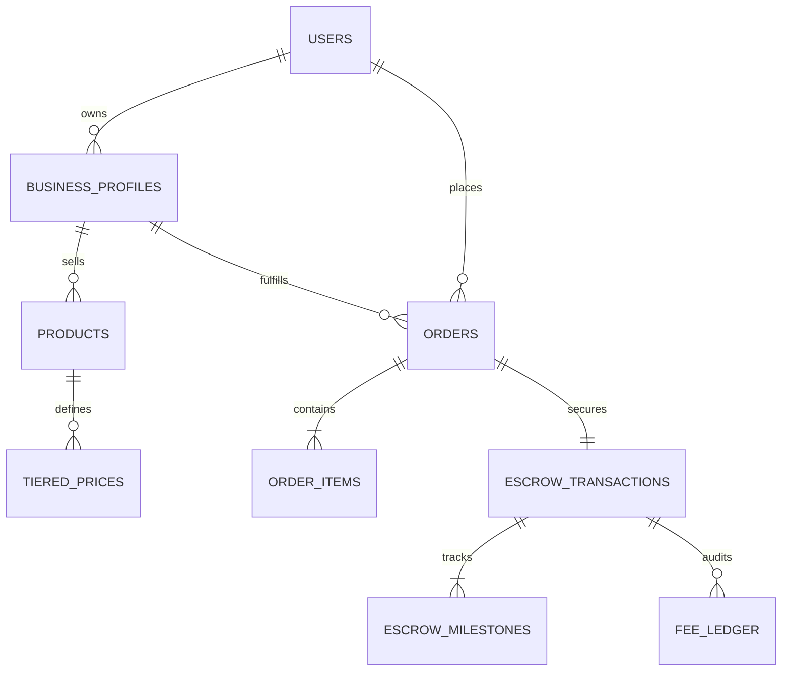

# PostgreSQL Database Architecture & Schema: Noryvanta

## 1. Relational Entity-Relationship Model (ERD)



---

## 2. Table Specifications & DDL

### 1. `users` Table
Stores core identity and role mapping.
```sql
CREATE TYPE user_role AS ENUM ('BUYER', 'VENDOR', 'ADMIN', 'AUDITOR');
CREATE TYPE auth_provider AS ENUM ('OTP', 'GOOGLE', 'MICROSOFT', 'SAML');

CREATE TABLE users (
    id UUID PRIMARY KEY DEFAULT gen_random_uuid(),
    phone VARCHAR(20) UNIQUE,
    email VARCHAR(255) UNIQUE,
    hashed_password VARCHAR(255),
    role user_role NOT NULL DEFAULT 'BUYER',
    auth_provider auth_provider NOT NULL DEFAULT 'OTP',
    is_active BOOLEAN NOT NULL DEFAULT TRUE,
    is_verified BOOLEAN NOT NULL DEFAULT FALSE,
    created_at TIMESTAMPTZ NOT NULL DEFAULT NOW(),
    updated_at TIMESTAMPTZ NOT NULL DEFAULT NOW()
);

CREATE INDEX idx_users_email ON users(email);
CREATE INDEX idx_users_phone ON users(phone);
```

### 2. `business_profiles` Table
Stores vendor compliance, GSTIN, and virtual escrow identifiers.
```sql
CREATE TYPE kyc_status AS ENUM ('NOT_SUBMITTED', 'PENDING_VERIFICATION', 'VERIFIED', 'REJECTED');
CREATE TYPE verification_tier AS ENUM ('STANDARD', 'SILVER', 'GOLD', 'SOVEREIGN_PLATINUM');

CREATE TABLE business_profiles (
    id UUID PRIMARY KEY DEFAULT gen_random_uuid(),
    user_id UUID NOT NULL REFERENCES users(id) ON DELETE CASCADE,
    legal_name VARCHAR(255) NOT NULL,
    trade_name VARCHAR(255) NOT NULL,
    business_type VARCHAR(50) NOT NULL,
    gstin VARCHAR(15) UNIQUE NOT NULL,
    pan VARCHAR(10) NOT NULL,
    bank_account_number VARCHAR(35) NOT NULL,
    bank_ifsc VARCHAR(11) NOT NULL,
    virtual_escrow_account_id VARCHAR(50) UNIQUE,
    kyc_status kyc_status NOT NULL DEFAULT 'NOT_SUBMITTED',
    tier verification_tier NOT NULL DEFAULT 'STANDARD',
    rating NUMERIC(3, 2) DEFAULT 5.00,
    total_sales_volume NUMERIC(15, 2) DEFAULT 0.00,
    created_at TIMESTAMPTZ NOT NULL DEFAULT NOW(),
    updated_at TIMESTAMPTZ NOT NULL DEFAULT NOW()
);

CREATE INDEX idx_biz_gstin ON business_profiles(gstin);
CREATE INDEX idx_biz_user ON business_profiles(user_id);
```

### 3. `products` & `tiered_prices` Tables
Supports B2B wholesale pricing with Minimum Order Quantities (MOQ).
```sql
CREATE TABLE products (
    id UUID PRIMARY KEY DEFAULT gen_random_uuid(),
    business_id UUID NOT NULL REFERENCES business_profiles(id) ON DELETE CASCADE,
    title VARCHAR(255) NOT NULL,
    slug VARCHAR(255) UNIQUE NOT NULL,
    description TEXT NOT NULL,
    category VARCHAR(100) NOT NULL,
    hsn_code VARCHAR(10) NOT NULL,
    gst_rate NUMERIC(5, 2) NOT NULL DEFAULT 18.00,
    base_price NUMERIC(12, 2) NOT NULL,
    moq INTEGER NOT NULL DEFAULT 1,
    stock_quantity INTEGER NOT NULL DEFAULT 0,
    images JSONB NOT NULL DEFAULT '[]'::JSONB,
    specifications JSONB NOT NULL DEFAULT '{}'::JSONB,
    is_active BOOLEAN NOT NULL DEFAULT TRUE,
    created_at TIMESTAMPTZ NOT NULL DEFAULT NOW(),
    updated_at TIMESTAMPTZ NOT NULL DEFAULT NOW()
);

CREATE TABLE tiered_prices (
    id UUID PRIMARY KEY DEFAULT gen_random_uuid(),
    product_id UUID NOT NULL REFERENCES products(id) ON DELETE CASCADE,
    min_quantity INTEGER NOT NULL,
    max_quantity INTEGER, -- NULL implies infinity (e.g. 500+ units)
    unit_price NUMERIC(12, 2) NOT NULL
);

CREATE INDEX idx_products_category ON products(category);
CREATE INDEX idx_products_biz ON products(business_id);
```

### 4. `orders` & `order_items` Tables
Enterprise purchase orders and tax calculations.
```sql
CREATE TYPE order_status AS ENUM ('CREATED', 'PAID_IN_ESCROW', 'PROCESSING', 'DISPATCHED', 'DELIVERED', 'COMPLETED', 'CANCELLED');

CREATE TABLE orders (
    id UUID PRIMARY KEY DEFAULT gen_random_uuid(),
    order_number VARCHAR(30) UNIQUE NOT NULL,
    buyer_id UUID NOT NULL REFERENCES users(id),
    vendor_id UUID NOT NULL REFERENCES business_profiles(id),
    subtotal NUMERIC(15, 2) NOT NULL,
    gst_total NUMERIC(15, 2) NOT NULL,
    platform_fee NUMERIC(15, 2) NOT NULL,
    total_amount NUMERIC(15, 2) NOT NULL,
    status order_status NOT NULL DEFAULT 'CREATED',
    shipping_address JSONB NOT NULL,
    created_at TIMESTAMPTZ NOT NULL DEFAULT NOW(),
    updated_at TIMESTAMPTZ NOT NULL DEFAULT NOW()
);

CREATE TABLE order_items (
    id UUID PRIMARY KEY DEFAULT gen_random_uuid(),
    order_id UUID NOT NULL REFERENCES orders(id) ON DELETE CASCADE,
    product_id UUID NOT NULL REFERENCES products(id),
    quantity INTEGER NOT NULL,
    unit_price NUMERIC(12, 2) NOT NULL,
    gst_rate NUMERIC(5, 2) NOT NULL,
    line_total NUMERIC(15, 2) NOT NULL
);
```

### 5. `escrow_transactions` & `fee_ledger` Tables
Financial auditability and dispute integrity.
```sql
CREATE TYPE escrow_status AS ENUM (
    'INITIATED', 'FUNDED', 'RELEASED_PARTIAL', 'RELEASED_FULL', 'DISPUTED', 'REFUNDED'
);

CREATE TABLE escrow_transactions (
    id UUID PRIMARY KEY DEFAULT gen_random_uuid(),
    order_id UUID UNIQUE NOT NULL REFERENCES orders(id),
    buyer_id UUID NOT NULL REFERENCES users(id),
    vendor_id UUID NOT NULL REFERENCES business_profiles(id),
    amount_locked NUMERIC(15, 2) NOT NULL,
    platform_fee_retained NUMERIC(15, 2) NOT NULL,
    tds_deducted NUMERIC(15, 2) NOT NULL DEFAULT 0.00,
    amount_disbursed NUMERIC(15, 2) NOT NULL DEFAULT 0.00,
    status escrow_status NOT NULL DEFAULT 'INITIATED',
    payment_reference VARCHAR(100),
    disbursed_at TIMESTAMPTZ,
    created_at TIMESTAMPTZ NOT NULL DEFAULT NOW()
);

CREATE TABLE fee_ledger (
    id UUID PRIMARY KEY DEFAULT gen_random_uuid(),
    escrow_id UUID NOT NULL REFERENCES escrow_transactions(id),
    fee_type VARCHAR(50) NOT NULL, -- 'PLATFORM_COMMISSION', 'TDS_194O', 'GATEWAY_ROUTING_FEE'
    amount NUMERIC(15, 2) NOT NULL,
    tax_percentage NUMERIC(5, 2) NOT NULL,
    currency VARCHAR(3) NOT NULL DEFAULT 'INR',
    recorded_at TIMESTAMPTZ NOT NULL DEFAULT NOW()
);
```
