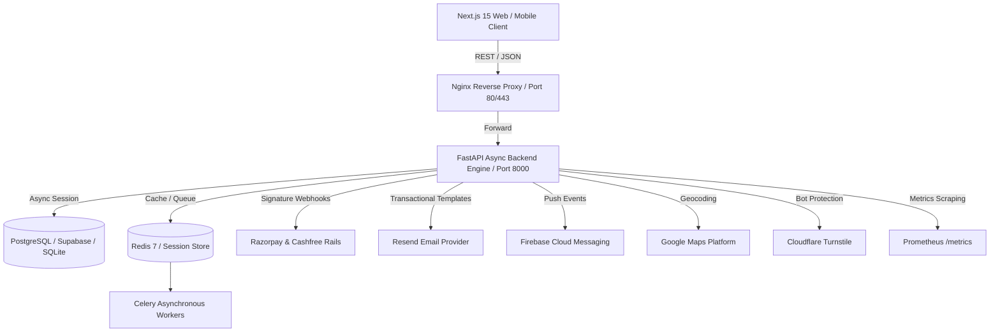

# Noryvanta.in — Sovereign Commerce Marketplace & Operating System

<div align="center">


**Connect, Supply, Empower** • **Connect, Grow, Thrive**

*India's Trusted Enterprise Business Marketplace & Operating System for Manufacturers, Wholesalers, Distributors, Retailers, and Skilled Service Specialists.*

[](https://python.org)
[](https://fastapi.tiangolo.com)
[](https://nextjs.org)
[](https://react.dev)
[](https://www.typescriptlang.org)
[](https://www.sqlalchemy.org)
[](backend/alembic/)
[](backend/tests/)

</div>

---

## 📌 Executive Summary

**Noryvanta** (`Noryvanta.in`) is an enterprise-grade digital marketplace and business operating system engineered for India's B2B and B2C commerce ecosystem. It seamlessly unites manufacturers, bulk wholesalers, regional distributors, retail store operators, corporate service enterprises, and verified home service professionals on a single sovereign platform.

### Core Value Propositions & Business Invariants
1. **Zero Buyer Platform Fee Guarantee**: Consumers and purchasing businesses pay strictly `Subtotal + GST`. Platform fees and statutory deductions are assessed exclusively vendor-side within automated financial settlement ledgers.
2. **Correct Net Business Transaction Base (Section 32)**: Platform fees are calculated exclusively on the **Net Eligible Product/Service Value** (`Item Subtotal - Vendor-Funded Discounts`). Platform fees are never levied on taxes, shipping, payment gateway fees, or platform vouchers.
3. **Cumulative Referral Qualification (Sections 33–34)**: Level progression does not require single large orders. Transactions accumulate cumulatively within the active cycle against standard level units:
   - **Wholesaler**: ₹1,00,000 per level
   - **Distributor**: ₹10,000 per level
   - **Services**: ₹5,000 per level
   - **Retailer**: ₹5,000 per level
4. **Deterministic Cycle-Boundary Resolution (Section 53)**:
   - Current active cycle has strict priority.
   - When a transaction reaches Level 120, it completes Cycle 1 and unlocks the Legendary rank reward.
   - Only the remaining unconsumed transaction volume crosses into Cycle 2 as the opening qualifying balance (starting at Level 0).
   - Zero double-counting: $\sum \text{Allocations} \le \text{Eligible Transaction Amount}$.
5. **Strict Listing Verification & 6-Image Rule**: Products require a minimum of 6 verified high-resolution images (`HTTP 422` enforced). Listings follow an audited lifecycle: `DRAFT` → `SUBMITTED` → `UNDER_REVIEW` → `ACTIVE`.
6. **Merchant Privacy Guarantee**: Public marketplace APIs isolate vendor identities (`trade_name`, `city`, `rating`, `is_verified`), never exposing sensitive banking credentials, PAN, or virtual escrow IDs to consumers.
7. **Double-Entry Financial Ledger**: Append-only ledgers record gross sales, platform fees, Section 194-O TDS (1%), GST, and net vendor settlements with T+1 bank payouts.

---

## 🏛️ System Architecture



---

## 📂 Project Structure

```
Noryvanta_Web/
├── .env.example                      # Root environment variable template
├── .gitignore                        # Secret & database protection (.env, db files)
├── ARCHITECTURE_DECISIONS.md         # Documented architectural records & invariant rationales
├── CHANGELOG.md                      # Chronological change log
├── DEPLOYMENT.md                     # Production deployment procedures (Docker / Cloud / Supabase)
├── SECURITY.md                       # Security practices, threat model & compliance protocols
├── SETUP.md                          # Local developer quick-start guide
├── docker-compose.yml                # Multi-container stack (postgres, redis, backend, celery, nginx, prometheus, grafana)
├── docs/                             # Exhaustive architectural blueprints & specifications
│   ├── API.md
│   ├── Architecture.md
│   ├── Backend.md
│   ├── Design.md
│   ├── Frontend.md
│   ├── Govt_Rules.md
│   ├── Policies.md
│   └── Terms & Condition.md
├── infra/                            # Infrastructure configuration files
│   ├── grafana/                      # Dashboards & datasource definitions
│   ├── nginx/                        # Nginx reverse proxy configuration
│   └── prometheus/                   # Prometheus scraping configuration
├── backend/                          # FastAPI Backend Engine (Python 3.14 / SQLAlchemy 2.0 Async)
│   ├── alembic/                      # Multi-stage database migration sequence
│   │   ├── env.py
│   │   └── versions/
│   │       ├── 001_businesses_table.py
│   │       ├── 002_add_gst_number.py
│   │       ├── 003_add_verification_status.py
│   │       ├── 004_add_business_category.py
│   │       ├── 005_add_network_referral_reward_system.py
│   │       ├── 006_add_uaid_and_quarterly_rules.py
│   │       ├── 007_versioned_platform_fee_rules.py
│   │       ├── 008_fee_transaction_base_and_financial_breakdown.py
│   │       ├── 009_level_progression_ledger.py
│   │       └── 010_cycle_transition_and_allocations.py
│   ├── app/
│   │   ├── api/
│   │   │   ├── deps.py               # Dependency injection (get_current_user, get_current_admin)
│   │   │   └── v1/
│   │   │       ├── api.py            # Aggregates 17 modular route handlers
│   │   │       └── endpoints/        # admin, auth, businesses, escrow, fees, kyc, marketplace, network, orders, payments, products, referrals, rewards, settlements
│   │   ├── core/                     # Database, security & Pydantic v2 settings
│   │   ├── models/                   # SQLAlchemy declarative models (business, network, order, escrow, kyc, audit)
│   │   ├── schemas/                  # Pydantic v2 validation schemas
│   │   └── services/                 # Business logic, fee calculation, network progression & adapters
│   ├── tests/                        # 18 test suites (111 passed tests)
│   └── requirements.txt              # Backend dependencies
└── frontend/                         # Next.js 15.5 (React 19) Frontend App
    ├── public/                       # High-res logos, icons, static assets
    ├── src/
    │   ├── app/                      # 18 App Router pages (admin, checkout, dashboard, products, vendor, rank-tracker)
    │   ├── components/               # UI components, layout (Navbar, Footer, MobileNav), trust badges
    │   ├── contexts/                 # React contexts (Country, Language, Marketplace, PaymentGateway)
    │   ├── lib/                      # API client, fee configuration, network progress utilities
    │   └── styles/                   # Modern styling & Tailwind CSS
    └── package.json                  # Frontend dependencies
```

---

## 🗄️ Database Migrations (Alembic)

The backend employs a fully versioned, reversible Alembic migration chain:

| Version | Migration Script | Description |
| :---: | :--- | :--- |
| **001** | `001_businesses_table.py` | Baseline schema for business profiles, addresses, contact details. |
| **002** | `002_add_gst_number.py` | Adds GSTIN statutory identifier & formatting validators. |
| **003** | `003_add_verification_status.py` | Multi-tier merchant verification statuses (`PENDING`, `VERIFIED`, `REJECTED`). |
| **004** | `004_add_business_category.py` | Canonical business tier categories (`WHOLESALER`, `DISTRIBUTOR`, `RETAILER`, `SERVICES`). |
| **005** | `005_add_network_referral_reward_system.py` | Network members, referrals, level records, rewards ledger. |
| **006** | `006_add_uaid_and_quarterly_rules.py` | Permanent Unique Account Identifiers (UAID) & quarterly activity tracking. |
| **007** | `007_versioned_platform_fee_rules.py` | Versioned platform fee schedules & historical audit immutability. |
| **008** | `008_fee_transaction_base_and_financial_breakdown.py` | Net Business Transaction Base, discount ownership, tax/shipping isolation. |
| **009** | `009_level_progression_ledger.py` | Immutable append-only level progression event stream (`LEVEL_COMPLETED`, `RANK_COMPLETED`). |
| **010** | `010_cycle_transition_and_allocations.py` | Multi-cycle transition records (`NetworkCycle`) & granular double-entry allocation rows (`LevelQualificationAllocation`). |

---

## 💰 Financial Architecture & Statutory Rules

### 1. Platform Fee Schedule by Business Tier
Vendor platform fees are deducted during settlement:
* **Wholesaler**: `3.20%`
* **Distributor**: `5.20%`
* **Services**: `5.20%`
* **Retailer**: `8.20%`

### 2. Section 32: Transaction Base Separation
Platform fees are strictly calculated on the **Net Eligible Business Transaction Value**:
$$\text{Eligible Net Product Value} = \text{Product Subtotal} - \text{Vendor Item Discounts} - \text{Vendor Subtotal Discounts}$$
$$\text{Platform Fee} = \text{Eligible Net Value} \times \text{Tier Fee \%}$$
$$\text{Settlement} = \text{Gross Order} - \text{Platform Fee} - \text{TDS (1\%)} - \text{Payment Gateway Charges}$$

* Buyers never pay platform fees.
* Platform vouchers funded by Noryvanta are never deducted from the vendor's transaction base.

---

## 🌐 120-Level Network Progression & Section 53 Cycle Boundary Rule

The network progression system manages 120 qualification levels spanning 12 milestone ranks (Bronze through Legendary):

```text
Level 1–10   : Bronze         Level 71–80  : Ruby
Level 11–20  : Silver         Level 81–90  : Sapphire
Level 21–30  : Gold           Level 91–100 : Emerald
Level 31–40  : Platinum       Level 101–110: Diamond
Level 41–50  : Pearl          Level 111–120: Legendary
Level 51–60  : Ruby-Lite      Reward       : ₹10,00,000
Level 61–70  : Emerald-Lite
```

### Deterministic Cycle-Boundary Sequence (Section 53)
When a transaction spans across cycle boundaries:
1. **Current Cycle Priority**: The transaction is first applied to finish remaining levels in the current active cycle.
2. **Cycle 1 Completion**: Once Level 120 is reached, Cycle 1 is closed, Legendary rank is confirmed, and the Legendary reward is credited.
3. **Carry-Forward Creation**: Exactly the remaining unconsumed transaction volume is carried forward:
   $$\text{Carry-Forward to Cycle 2} = \text{Transaction Amount} - \text{Amount Consumed in Cycle 1}$$
4. **Cycle 2 Initialization**: Cycle 2 opens at Level 0 with the carried amount as its opening qualifying balance, immediately qualifying consecutive levels without double-counting.
5. **Traceability**: Every transaction maintains granular [LevelQualificationAllocation](file:///f:/PROJECT/Project/Noryvanta_Web/backend/app/models/network.py) records tracking exact rupee consumption per cycle and level.

---

## 🚀 Quick-Start Guide

### Prerequisites
- **Python**: `>= 3.13` (Tested on Python 3.14.5)
- **Node.js**: `>= 20.x` (Tested with npm 10.x)
- **Database**: PostgreSQL / Supabase (or SQLite for local development)
- **Cache / Queue**: Redis 7 & Celery

---

### 1. Backend Setup

```bash
# Navigate to backend directory
cd backend

# Create virtual environment
python -m venv venv

# Activate virtual environment
# Windows:
.\venv\Scripts\activate
# Linux/macOS:
source venv/bin/activate

# Install dependencies
pip install -r requirements.txt

# Configure environment variables
cp .env.example .env

# Apply database migrations
alembic upgrade head

# Start FastAPI development server
uvicorn app.main:app --reload --port 8000
```

- **Interactive Swagger UI**: [http://localhost:8000/docs](http://localhost:8000/docs)
- **ReDoc Documentation**: [http://localhost:8000/redoc](http://localhost:8000/redoc)
- **Prometheus Metrics**: [http://localhost:8000/metrics](http://localhost:8000/metrics)

---

### 2. Frontend Setup

```bash
# Navigate to frontend directory
cd frontend

# Install dependencies
npm install

# Configure environment variables
cp .env.example .env.local

# Start Next.js development server
npm run dev
```

- **Application URL**: [http://localhost:3000](http://localhost:3000)

---

### 3. Automated Test Suite Execution

All **111 tests** pass across 18 test suites validating business rules, financial invariants, and cycle boundaries:

```bash
# From backend directory with venv activated:
python -m pytest -v
```

```text
============================= test session starts =============================
tests/test_auth.py .................................................... [  4%]
tests/test_business_registration_master.py ......                       [ 10%]
tests/test_critical_business_rules.py ....                              [ 14%]
tests/test_escrow.py .                                                  [ 15%]
tests/test_integrations.py ......                                       [ 21%]
tests/test_kyc_and_bank_verification_rules.py ...........               [ 31%]
tests/test_marketplace.py ..                                            [ 33%]
tests/test_network_progress.py .                                        [ 34%]
tests/test_platform_fee_migration_and_rules.py ......                   [ 40%]
tests/test_products.py .                                                [ 41%]
tests/test_progressive_quarterly_workflow.py .......                    [ 47%]
tests/test_referral_reward_engine.py ......                             [ 53%]
tests/test_section32_transaction_base.py .....                          [ 58%]
tests/test_section33_level_qualification.py .....                       [ 63%]
tests/test_section34_to_52_cycles_and_allocations.py ........           [ 70%]
tests/test_section53_cycle_boundary_remainder.py .....                 [ 75%]
tests/test_uaid_quarterly_repeat_rules.py ...............               [ 88%]
tests/test_uaid_reactivation_purchase_requirement.py .........          [100%]
============================= 111 passed in 60.42s ============================
```

#### Production Build Validation:
```bash
cd frontend
npm run build
```
- **Result**: 18 / 18 App Router pages statically compiled with 0 TypeScript/ESLint errors.

---

## 🛒 Marketplace API Reference

The public marketplace API is decoupled, stateless, and consumable by Web, Mobile, Android, iOS, and Admin clients:

| Method | Endpoint | Description |
| :--- | :--- | :--- |
| `GET` | `/api/v1/marketplace/products` | Active products filtered by category, merchant tier (Wholesaler, Distributor, Retailer), price, and location. |
| `GET` | `/api/v1/marketplace/products/{id}` | Detail view of a single active product with public merchant credentials. |
| `GET` | `/api/v1/marketplace/services` | Active services filtered by category, provider tier (Registered Service Provider, Skilled Home Services). |
| `GET` | `/api/v1/marketplace/services/{id}` | Detail view of a single active service with booking information and service charge. |
| `GET` | `/api/v1/marketplace/categories` | 12 canonical categories with live active product and service counts. |
| `GET` | `/api/v1/marketplace/featured` | Curated active products and services for home page showcases. |
| `GET` | `/api/v1/marketplace/search` | Unified search across products and services with full text and category filters. |
| `GET` | `/api/v1/network/progress/{user_id}` | Member's live 120-level hierarchy status, active cycle, and carry-forward balance. |
| `GET` | `/api/v1/network/cycles/{member_id}` | Complete historical cycle progression and carry-forward audit trail. |
| `GET` | `/api/v1/network/allocations/{tx_id}` | Traceable qualification volume allocations per cycle and level. |
| `POST` | `/api/v1/admin/listings/{id}/approve` | Admin approval transition setting status to `ACTIVE` and publishing to marketplace. |
| `POST` | `/api/v1/admin/listings/{id}/reject` | Admin rejection with reason logged in immutable `AuditLog`. |

---

## 🔒 Security & Statutory Compliance

- **Section 194-O TDS & GST**: Automatically withholds 1.0% TDS on gross e-commerce sales and applies GST (5%, 12%, 18%, 28%) to vendor settlements.
- **Strict Role-Based Access Control (RBAC)**: Enforced via `get_current_user` and `get_current_admin` dependencies for `CUSTOMER`, `BUYER`, `VENDOR`, and `ADMIN`.
- **HMAC Signature Verification**: Razorpay (`x-razorpay-signature`) and Cashfree (`x-cashfree-signature`) webhooks verify cryptographic signatures with idempotency locks.
- **Bot Defense**: Cloudflare Turnstile token validation protects OTP dispatch and registration endpoints.
- **Secret Protection**: `.gitignore` strictly protects `.env`, `.env.*`, and all local database files.

---

## 📄 License & Intellectual Property

Copyright © 2026 **Noryvanta Technologies Private Limited**. All Rights Reserved.  
Proprietary commercial software. Unauthorized reproduction, distribution, or decompilation is strictly prohibited.
